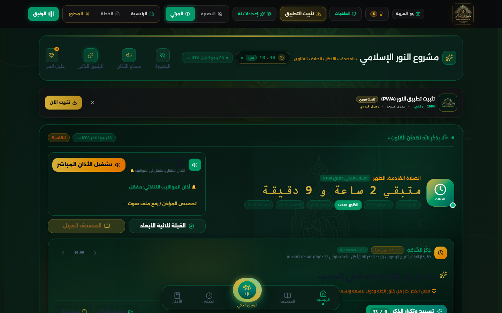
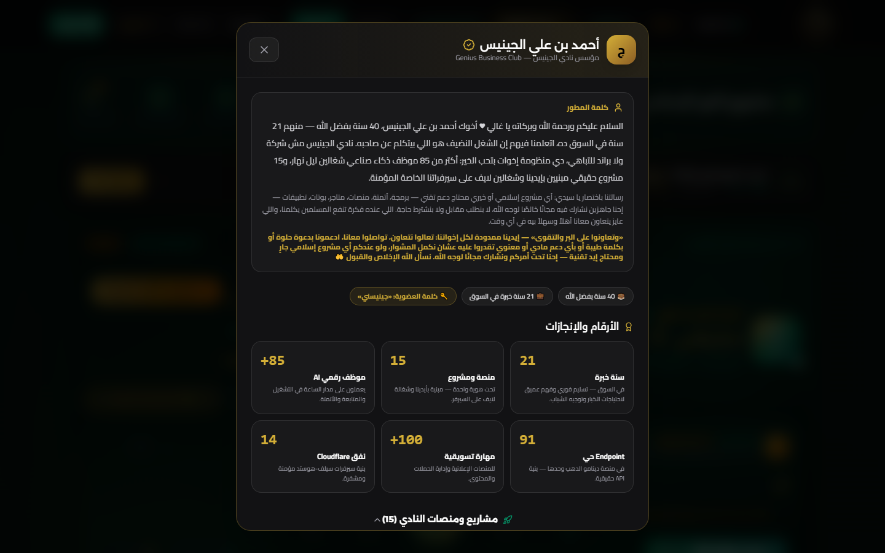
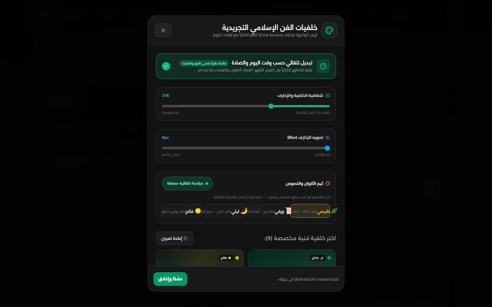
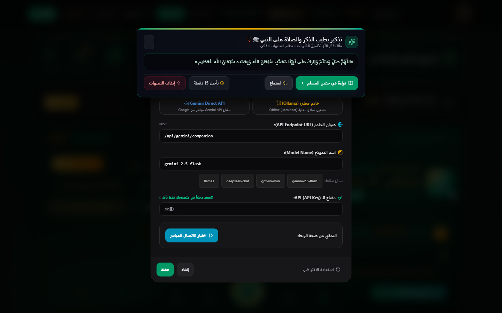
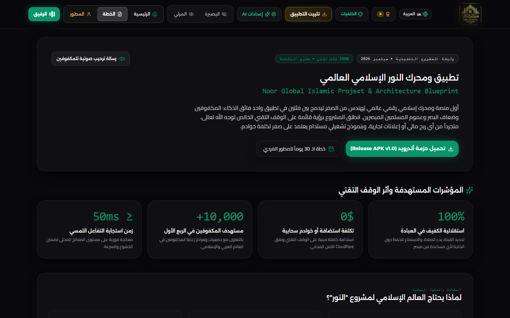
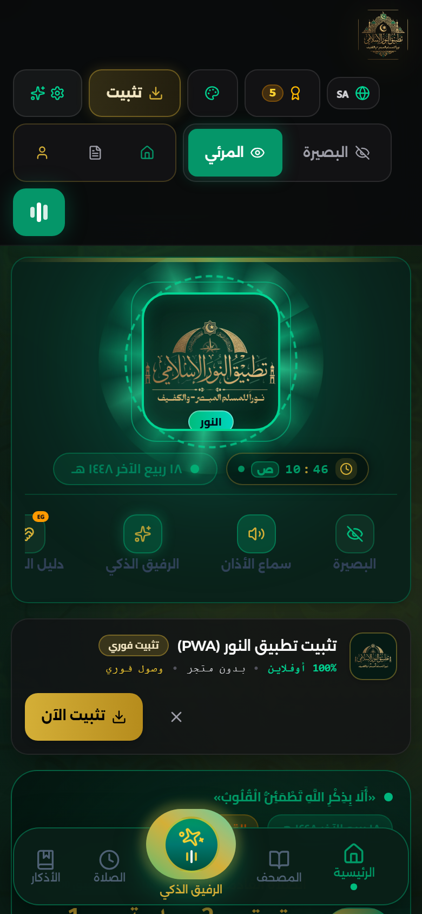

<div align="center">

# 🕌 تطبيق النور الإسلامي
# Noor Global Islamic Project

### ✨ نوراً للمسلم المبصر والكفيف — Light for every sighted & blind Muslim ✨

[](https://noor.zka2soba3y.com/)
[](./LICENSE)
[](https://noor.zka2soba3y.com/)
[](https://react.dev/)
[](https://www.typescriptlang.org/)
[](https://nodejs.org/)

**🚀 [جرّب التطبيق الحي الآن — Try the Live App](https://noor.zka2soba3y.com/) • 📱 يعمل على الموبايل والكمبيوتر • 🆓 مجاني 100% للأبد**

</div>

---

<div dir="rtl">

## 📸 لقطات الشاشة | Screenshots

| الرئيسية (كمبيوتر) | صفحة المطور |
|---|---|
|  |  |

| الخلفيات والثيمات | إعدادات الذكاء الاصطناعي |
|---|---|
|  |  |

| الملف التقديمي (الخطة) | الرئيسية (موبايل) |
|---|---|
|  |  |

---

## 🌟 ما هو تطبيق النور؟ | What is Noor?

**تطبيق ويب تقدّمي (PWA) إسلامي شامل، وقفٌ تقني خالص لوجه الله تعالى** — بلا إعلانات، بلا تتبّع، بلا اشتراكات، بلا أي تكلفة على المسلم. صُمم خصيصًا **لدمج المكفوفين وضعاف البصر** مع عموم المسلمين في تجربة عبادية مستقلة وخاشعة.

**An all-in-one Islamic Progressive Web App — a pure technical endowment (Waqf) for the sake of Allah.** No ads, no tracking, no subscriptions, zero cost for the Muslim user. Built first-class **for blind and visually-impaired Muslims**, together with all Muslims, in one independent, serene worship experience.

### ✨ المزايا | Features

| 🕌 الميزة | الوصف |
|---|---|
| 📖 مصحف المدينة (604 صفحة) | عرض كامل + تلاوة صوتية لكل آية بنخبة القراء |
| 🧠 رفيق النور الذكي | مساعد صوتي (Gemini) بالعربية — أسئلة، أذكار، ودعم نفسي |
| 👁️ عين البصيرة | وصف المشهد عبر الكاميرا للمكفوفين |
| 🧭 مواقيت + قبلة | حسابات دقيقة، رادار قبلة اهتزازي، أذانات متعددة |
| 📿 أذكار وحصن المسلم | صباح/مساء/ساعية + تتبّع + تنبيهات ذكية |
| 🎓 محاضرات وبث حي | مكتبة دروس + بث الحرمين بتقنية HLS |
| 📅 تقويم هجري 🕌 مساجد 💰 زكاة 🏆 إنجازات | منظومة عبادية متكاملة |
| 🎨 9 خلفيات + 4 ثيمات | مزامنة تلقائية تُظهر النصوص بوضوح دائمًا |
| 📳 الوضع الحسي | واجهة صوتية كاملة للمكفوفين (لمس/اهتزاز/هز الجهاز) |
| 🌍 4 لغات | عربية RTL + English + Français + اردو |
| 📴 يعمل أوفلاين | PWA قابلة للتثبيت + تخزين محلي SQLite |

### 🛠️ التقنيات | Stack

`React 19` • `TypeScript` • `Tailwind v4` • `Three.js` • `Vite 6 + PWA` • `SQLite WASM` • `Node.js + Express` • `Google Gemini` • `Cloudflare Tunnel`

</div>

---

<div dir="rtl">

## 👤 عن المطور | About the Developer

### أحمد بن علي الجينيس — مؤسس نادي الجينيس (Genius Business Club)

> السلام عليكم ورحمة الله وبركاته يا غالي ♥ أخوك **أحمد بن علي الجينيس**، 40 سنة بفضل الله — منهم **21 سنة في السوق**. نادي الجينيس مش شركة للتباهي، دي **منظومة إخوات بتحب الخير**: أكتر من **85 موظف ذكاء صناعي** شغالين ليل نهار، و**15 مشروع حقيقي** مبنيين بإيدينا وشغالين لايف على سيرفراتنا الخاصة المؤمنة.

| 📊 الإنجاز | الرقم |
|---|---|
| 💼 سنوات الخبرة | **21 سنة** |
| 🚀 منصات ومشاريع لايف | **15 مشروع** |
| 🤖 موظفون رقميون (AI) | **+85** يعملون 24/7 |
| 🔌 Endpoints حية | **91** |
| 📣 مهارات تسويقية | **+100** |
| 🔒 أنفاق Cloudflare خاصة | **14** |

**📞 التواصل المباشر:**
- 📱 اتصال/واتساب: `01274608158` — `01130680225`
- 💬 واتساب دولي: [+201130680225](https://wa.me/201130680225)
- ✉️ البريد: [ceo@gbc4.com](mailto:ceo@gbc4.com)
- 🌐 الموقع: [www.gbc4.com](https://www.gbc4.com)

</div>

---

<div dir="rtl">

## 🤝 الدعم والشراكة والتعاون | Support & Partnership

> **«وتعاونوا على البر والتقوى»** — إيدينا ممدودة لكل إخواتنا في كل مكان.

نطمح معًا أن يصل **تطبيق النور** إلى **تطبيق إسلامي عالمي** يخدم **المكفوفين والمبصرين والمسلمين أجمعين**. وهذا لا يتحقق بفرد — بل بأمة تتعاون:

| 🤲 كيف تشارك؟ | التفاصيل |
|---|---|
| 💰 **دعم مادي** | تكاليف السيرفرات والمفاتيح والتطوير — كل جنيه صدقة جارية ([تواصل واتساب](https://wa.me/201130680225)) |
| 💚 **دعم معنوي** | دعوة بظهر الغيب، كلمة طيبة، نشر التطبيق بين أهلك وجمعيتك ومسجدك |
| 💻 **تطوير وتعاون تقني** | انسخ المستودع (Fork) وطوّر — أو راسلنا للعمل معًا على مزايا جديدة |
| 🕌 **مشاريع إسلامية** | عندك مشروع إسلامي جارٍ ومحتاج إيد تقنية؟ **نشارك مجانًا لوجه الله** — برمجة، أتمتة، منصات، بوتات |
| 🌍 **ترجمة ونشر** | ترجم التطبيق للغتك، انشره باسمك في بلدك — **لا إذن ولا نسب مطلوب** |

**Our goal — a global Islamic app for the blind, the sighted, and all Muslims.** We invite developers, charities, mosques, and companies worldwide: fork it, translate it, publish it under your name, or partner with us. Everything is free, forever, for Allah's sake.

### 📬 فورم التواصل داخل التطبيق
من صفحة **"عن المطور"** داخل التطبيق ستجد فورم **تواصل / دعم / تعاون** يرسل رسالتك مباشرة إلى واتساب المطور. أو تواصل الآن: [💬 واتساب مباشر](https://wa.me/201130680225)

</div>

---

<div dir="rtl">

## 🌍 رسالة مفتوحة: هذا العمل ملكٌ للأمة كلها

**نُقدّم هذا المشروع كاملاً ومجاناً لكل المستخدمين والمطورين في الأرض — مفتوح المصدر بالكامل (CC0):** خُذه، طوّره، انشره، انسبه لنفسك، أعد تسميته — **بلا إذن من أحد**. إن نشره أحدٌ بشكل أنجح وطوّره بشكل أفضل، **فكلنا نشترك في عملٍ واحد، لعلّ الله أن ينفع بنا.**

> **«إنما الأعمال بالنيّات»** — نواجه الله بهذا العمل خالصًا. 🤲

</div>

---

<div dir="rtl">

## 🚀 التشغيل | Quickstart

```bash
git clone https://github.com/ahmed-genius/noor-islamic-app.git
cd noor-islamic-app
npm install
cp .env.example .env   # ضع مفتاح Gemini الخاص بك
npm run dev            # http://localhost:3000
```

```bash
npm run build   # بناء الإنتاج
npm start       # تشغيل خادم الإنتاج
npm run lint    # فحص الأنواع
```

### 🔐 البيئة | Environment

| المتغير | الوصف |
|---|---|
| `GEMINI_API_KEY` ✅ | مفتاح [Google AI Studio](https://aistudio.google.com/app/apikey) لمزايا الذكاء الاصطناعي |
| `CUSTOM_AI_*` — | مزود OpenAI-compatible اختياري (DeepSeek/Groq/Ollama...) — راجع `.env.example` |
| `PORT` / `APP_URL` — | المنفذ والعنوان العام |

> ⚠️ لا ترفع `.env` أبدًا — راجع [`SECURITY.md`](./SECURITY.md). التفاصيل الكاملة: [`deploy/README.md`](./deploy/README.md) • المساهمة: [`CONTRIBUTING.md`](./CONTRIBUTING.md) • التغييرات: [`CHANGELOG.md`](./CHANGELOG.md)

## 📄 الترخيص | License

**CC0 1.0 Universal (النطاق العام)** — لا حقوق محفوظة. راجع [`LICENSE`](./LICENSE).

</div>

<div align="center">

### 🤲 نسأل الله الإخلاص والقبول — وأن ينفع بهذا العمل كل مسلم ومسلمة في كل مكان

**[🌐 جرّب التطبيق الحي](https://noor.zka2soba3y.com/) • [👤 عن المطور](https://www.gbc4.com) • [💬 واتساب](https://wa.me/201130680225)**

</div>
