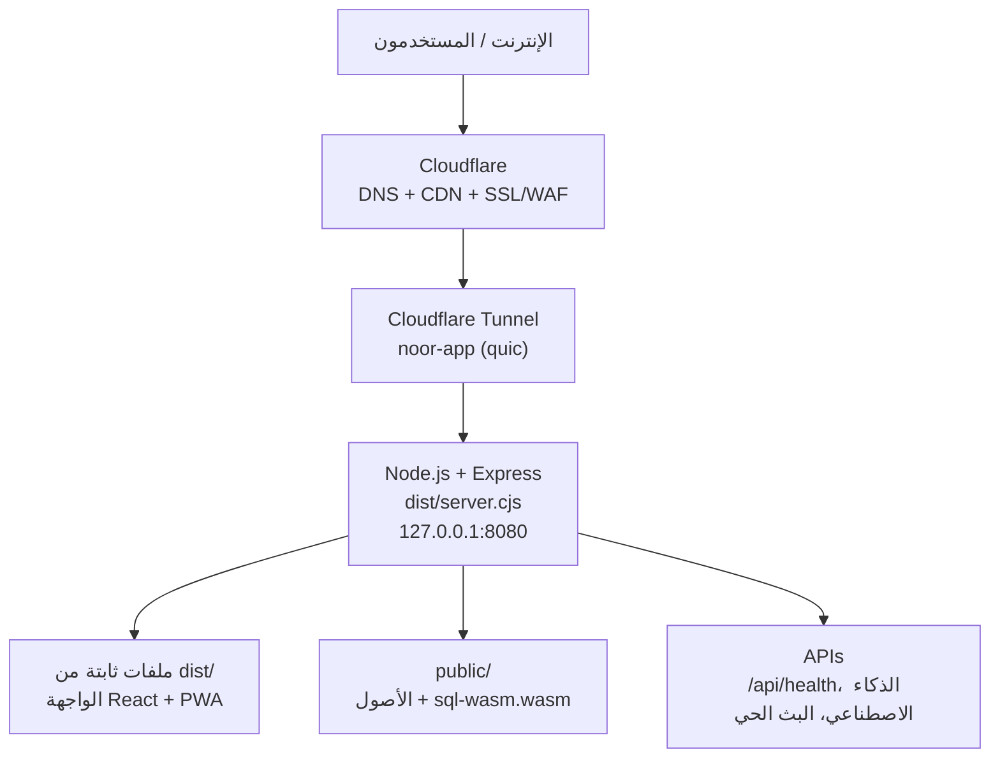

# 🕌 تطبيق النور الإسلامي — دليل النشر (الإنتاج)
## Cloudflare Tunnel + Node.js على منفذ 8080 — `noor.zka2soba3y.com`

> **ملاحظة:** هذا الدليل يوثّق **البنية الفعلية المُنفّذة** على سيرفر الإنتاج.
> الوثيقة السابقة كانت تصف بنية Nginx + NSSM وهي **غير مُستخدمة** (انظر `README.md.old`).

---

## 📋 نظرة عامة على البنية



**النقاط الأساسية:**
- **لا يوجد Nginx ولا NSSM ولا IIS في سلسلة هذا التطبيق.**
- النفق السحابي (Cloudflare Tunnel) يتصل بـ Cloudflare مباشرةً (اتصال صادر فقط)،
  لذا **لا حاجة لفتح أي منفذ وارد في الجدار الناري**.
- سيرفر الإنتاج هو جهاز Laragon (Windows) الموجود في `C:\laragon`.

---

## ✅ المتطلبات على السيرفر

| العنصر | الإصدار | طريقة التحقق |
|---|---|---|
| **Node.js** | 22.14.0 | `node -v` |
| **npm** | 10.9.2 | `npm -v` |
| **cloudflared** | مُضمّن في Laragon | `C:\laragon\bin\cloudflared.exe --version` |
| **PowerShell** | 5.1 | `$PSVersionTable.PSVersion` |

---

## 🚀 الخطوة 1 — بناء التطبيق

```powershell
cd "d:\Genius\Genius Business Club Nw Vision New Style\El-Noor-Islamic-App-main"

# تثبيت الحزم (مرة واحدة)
npm install

# البناء للإنتاج
npm run build
```

الناتج:
- `dist/index.html` + `dist/assets/` — الواجهة (React + PWA).
- `dist/server.cjs` — خادم Express المُجمَّع (esbuild، CJS).
- `dist/sw.js` + `dist/workbox-*.js` — Service Worker للـ PWA.
- `dist/sql-wasm.wasm` — قاعدة بيانات SQLite (WASM).

---

## ⚙️ الخطوة 2 — ملف البيئة `.env.production`

في جذر المشروع:

```ini
NODE_ENV=production
PORT=8080
APP_URL=https://noor.zka2soba3y.com

# محرك الذكاء الاصطناعي الأساسي (مطلوب)
GEMINI_API_KEY=your_gemini_key_here

# مزود إضافي اختياري (اتركه فارغًا لاستخدام Gemini فقط)
CUSTOM_AI_BASE_URL=
CUSTOM_AI_API_KEY=
CUSTOM_AI_MODEL=
```

> **تنبيه:** المنفذ **يجب أن يكون 8080** لأن إعداد النفق الموجود مسبقاً
> (`config-noor.yaml`) يتوقع `http://localhost:8080`.

---

## 🌐 الخطوة 3 — إعداد Cloudflare Tunnel

ملف الإعداد موجود مسبقاً ولا يحتاج تعديل:

**`C:\Users\Admin\.cloudflared\config-noor.yaml`**

```yaml
tunnel: 01b9f740-ca29-470f-a3a1-dad1fc42e298
credentials-file: C:\Users\Admin\.cloudflared\01b9f740-ca29-470f-a3a1-dad1fc42e298.json
logfile: C:\laragon\tunnel-noor.log
ingress:
  - hostname: noor.zka2soba3y.com
    service: http://localhost:8080
  - service: http_status:404
```

**سجل DNS:** سجل CNAME لـ `noor.zka2soba3y.com` يشير إلى معرّف النفق
`01b9f740-ca29-470f-a3a1-dad1fc42e298.cfargotunnel.com` (مُدار في لوحة Cloudflare).

---

## 🔄 الخطوة 4 — التشغيل الدائم (Watchdog)

### تشغيل الـ Watchdog

```powershell
# تشغيل يدوي (اختياري — يبدأ تلقائياً مع الويندوز)
Start-Process powershell `
  -ArgumentList '-NoProfile -ExecutionPolicy Bypass -WindowStyle Hidden -File C:\laragon\start-noor-stack.ps1' `
  -WindowStyle Hidden
```

الـ Watchdog (`C:\laragon\start-noor-stack.ps1`) يقوم بـ:
1. فحص المنفذ 8080 كل 60 ثانية — إذا لم يكن مستمعاً، يُشغّل `node dist/server.cjs`.
2. فحص عملية `cloudflared` مع `config-noor` — إذا لم تكن تعمل، يُشغّل النفق.
3. كتابة السجل إلى `C:\laragon\start-noor-stack.log`.

### بدء التشغيل التلقائي

تم إنشاء اختصار في مجلد Startup:

```
%APPDATA%\Microsoft\Windows\Start Menu\Programs\Startup\NoorStackWatchdog.lnk
```

> **لماذا مجلد Startup وليس Task Scheduler؟**
> `Register-ScheduledTask` يتطلب صلاحيات مسؤول مرفوعة (يفشل بـ "Access is denied"
> لجلسة Admin العادية)، بينما مجلد Startup يعمل بدونها وينفّذ عند تسجيل الدخول.

---

## 🧪 الخطوة 5 — فحوصات ما بعد النشر

```powershell
# 1. فحص الصحة
Invoke-WebRequest 'https://noor.zka2soba3y.com/api/health' -UseBasicParsing

# 2. فحص الصفحة الرئيسية
Invoke-WebRequest 'https://noor.zka2soba3y.com/' -UseBasicParsing | Select-Object StatusCode

# 3. فحص Service Worker (يجب أن يكون no-store)
Invoke-WebRequest 'https://noor.zka2soba3y.com/sw.js' -UseBasicParsing | Select-Object Headers

# 4. فحص WASM
Invoke-WebRequest 'https://noor.zka2soba3y.com/sql-wasm.wasm' -UseBasicParsing | Select-Object StatusCode
```

**النتيجة المتوقعة:**

| الفحص | النتيجة |
|---|---|
| `/api/health` | `200` + `{"status":"ok","app":"Noor Global Islamic Project",...}` |
| `/` | `200` + HTML عربي RTL |
| `/sw.js` | `200` + `Cache-Control: no-store` |
| `/sql-wasm.wasm` | `200` + `Content-Type: application/wasm` |
| `/manifest.webmanifest` | `200` |
| مسار غير موجود (SPA fallback) | `200` + HTML التطبيق |
| أيقونات PWA (192/512) | `200` |

---

## 🛠️ الصيانة

### إعادة النشر بعد تحديث الكود

```powershell
cd "d:\Genius\Genius Business Club Nw Vision New Style\El-Noor-Islamic-App-main"
git pull            # أو نسخ الملفات المحدّثة
npm install         # فقط إذا تغيّرت الحزم
npm run build       # إعادة البناء

# إعادة تشغيل التطبيق (الـ Watchdog سيلتقطه تلقائياً خلال 60 ثانية،
# أو أعد التشغيل يدوياً):
Stop-Process -Id (Get-NetTCPConnection -LocalPort 8080).OwningProcess -Force
# ← الـ Watchdog سيعيد تشغيله
```

### عرض السجلات

```powershell
# سجل الـ Watchdog
Get-Content 'C:\laragon\start-noor-stack.log' -Tail 50

# سجل النفق
Get-Content 'C:\laragon\tunnel-noor.log' -Tail 50
```

### حل المشاكل

| المشكلة | الحل |
|---|---|
| الموقع لا يفتح | تحقق أن `node dist/server.cjs` يعمل على 8080 والنفق يعمل |
| النفق متصل لكن الموقع 502 | المنفذ 8080 غير مستمع — أعد تشغيل التطبيق |
| `dist/` فارغ | نفّذ `npm run build` |
| خطأ في بناء الـ PWA | احذف `node_modules/.vite` وأعد البناء |

---

## 📁 الملفات الأساسية

| الملف | الوصف |
|---|---|
| `C:\laragon\start-noor-stack.ps1` | سكربت الـ Watchdog (التشغيل الدائم) |
| `%APPDATA%\...\Startup\NoorStackWatchdog.lnk` | بدء التشغيل التلقائي |
| `C:\Users\Admin\.cloudflared\config-noor.yaml` | إعداد النفق |
| `C:\laragon\start-noor-stack.log` | سجل الـ Watchdog |
| `C:\laragon\tunnel-noor.log` | سجل النفق |
| `.env.production` | متغيرات البيئة (المنفذ، المفاتيح) |

---

## 🔒 ملاحظات أمانية

- النفق يستخدم اتصالاً صادراً فقط — **لا تفتح أي منفذ وارد**.
- شهادة SSL يُديرها Cloudflare تلقائياً (لا حاجة لتجديد يدوي).
- **لا تُضمّن مفاتيح API في الكود** — استخدم `.env.production` دائماً.
- محرك الذكاء الاصطناعي الأساسي هو **Google Gemini**. ولإضافة مزود آخر
  (DeepSeek / Groq / Ollama / أي خادم OpenAI-compatible) املأ متغيرات
  `CUSTOM_AI_*` الاختيارية — راجع `.env.example`.
